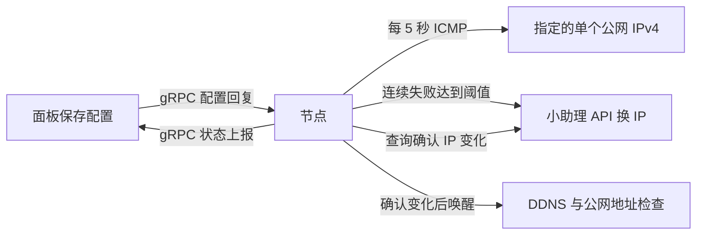

> 来源：Codex 调研会话 01a1b9aa-9960-7fa3-b614-571266677654

**核心结论：当前源码没有实现你描述的“全国各省份、各运营商检测指定 IP／端口”的功能。**实际存在的是：**节点定时 ping 一个指定的公网 IPv4，连续失败后调用小助理 API 更换云实例 IP**。检测方向是“节点 → 指定 IP”，与“全国检测点 → 被测服务器”不同。

以下基于当前工作区提交 `26a8dd8` 的静态源码调研；没有修改或创建文件，也没有调用外部接口验证其当前可用性。

## 1. 项目概览

### 技术栈与整体架构

| 部分 | 实际技术栈 |
|---|---|
| 面板前端 | Vue 3、Element Plus、TypeScript、Vite |
| 面板后端 | Go、标准库 `net/http`、gRPC、Protobuf |
| 面板数据库 | PostgreSQL，通过 pgx 访问 |
| 节点 | Go；本地用 bbolt 保存配置、身份、用量与任务状态 |

因此，项目本身使用的并非 React＋AntD，也不是 SQLite。依据：[前端依赖](/Users/macmini/Documents/Aixiaoji/源码参考/nekopass/web/package.json:6)、[Go 依赖](/Users/macmini/Documents/Aixiaoji/源码参考/nekopass/go.mod:3)、[数据库连接](/Users/macmini/Documents/Aixiaoji/源码参考/nekopass/internal/store/open.go:137)、[节点状态库](/Users/macmini/Documents/Aixiaoji/源码参考/nekopass/internal/agent/state.go:32)。

面板负责管理用户、规则、配额和节点配置；节点负责实际转发。主控默认提供 `8080` 网页/API 和 `9443` 节点控制服务。[服务入口](/Users/macmini/Documents/Aixiaoji/源码参考/nekopass/cmd/nekopass/main.go:36)

### 面板与节点如何通信

- **连接方向：节点主动连接面板。**协议是 gRPC＋Protobuf，控制接口为 `Connect(stream AgentMessage) returns (stream ControlMessage)`。[协议定义](/Users/macmini/Documents/Aixiaoji/源码参考/nekopass/api/control.proto:5)
- **实际交互节奏：节点上报 → 面板回复配置 → 节点应用 → 等待 1 秒 → 下一轮。**虽然协议支持双向流，当前实现采用这种请求、响应循环，没有独立的异步配置推送流程。[节点循环](/Users/macmini/Documents/Aixiaoji/源码参考/nekopass/internal/agent/client.go:66)、[面板接收和回复](/Users/macmini/Documents/Aixiaoji/源码参考/nekopass/internal/control/stream.go:61)
- **传输安全：**`https://` 使用验证系统根证书的 TLS，最低 TLS 1.2；显式配置 `http://` 时使用明文 h2c。面板支持直接终止 TLS，也支持由反向代理终止 TLS。[节点连接处理](/Users/macmini/Documents/Aixiaoji/源码参考/nekopass/internal/agent/control_endpoint.go:15)、[面板监听模式](/Users/macmini/Documents/Aixiaoji/源码参考/nekopass/internal/control/agent_listener.go:29)
- **鉴权与身份：**节点通过 gRPC metadata 发送 `authorization: Bearer <节点 token>`；面板按 token 哈希查找节点，同时绑定本地持久化的 instance ID，并限制同一节点同时建立多个控制会话。[发送凭据](/Users/macmini/Documents/Aixiaoji/源码参考/nekopass/internal/agent/client.go:67)、[服务端验证](/Users/macmini/Documents/Aixiaoji/源码参考/nekopass/internal/control/stream.go:30)、[实例身份校验](/Users/macmini/Documents/Aixiaoji/源码参考/nekopass/internal/control/stream.go:133)
- **配置下发：**面板组装带 revision 的配置快照，包含规则、用户策略、节点参数、隧道关系、DDNS、自动换 IP 等。节点先将配置持久化，再应用配置；当前不是仅发送变更字段的增量同步。[组装配置](/Users/macmini/Documents/Aixiaoji/源码参考/nekopass/internal/control/stream.go:276)、[节点保存并应用](/Users/macmini/Documents/Aixiaoji/源码参考/nekopass/internal/agent/engine.go:184)
- **状态上报：**包括累计流量、连接数、已应用 revision、同步错误、资源监控、公网 IP、DDNS、自动换 IP 和升级状态。控制连接中断后保留缓存配置，每 2 秒尝试重连。[报告内容](/Users/macmini/Documents/Aixiaoji/源码参考/nekopass/internal/agent/engine.go:550)、[断线处理](/Users/macmini/Documents/Aixiaoji/源码参考/nekopass/internal/agent/client.go:54)

## 2. 全国连通性检测：实际存在的实现

### 2.1 检测点来源与覆盖范围

当前源码中，没有找到 itdog、boce、17ce、ping.pe、chinaz 的接入，也没有全国探针目录、省份或运营商配置。

实际检测配置只有一个 `target_ip`：

| 项目 | 源码实际行为 |
|---|---|
| 检测发起方 | 启用自动换 IP 的节点自身 |
| 检测目标 | 管理员填写的一个公网 IPv4 |
| 每节点目标数量 | 1 个 |
| 省份／运营商覆盖 | 没有相应字段、清单或统计 |
| 国内地址校验 | 页面要求填写国内 IP，但后端仅校验公网 IPv4，没有验证其归属中国 |
| 任意 IP／端口手动拨测 | 没有发现对应接口 |

依据：[配置结构及校验](/Users/macmini/Documents/Aixiaoji/源码参考/nekopass/internal/iprecovery/config.go:15)、[前端输入项](/Users/macmini/Documents/Aixiaoji/源码参考/nekopass/web/src/views/AdminNodeIPRecoveryView.vue:28)。

实际链路如下：



### 2.2 检测类型与单次检测流程

**该功能只做 IPv4 ICMP Echo 检测，没有 TCP 端口或 HTTP 检测，也不计算 RTT 延迟。**

Linux 实现直接使用 Go 的 ICMP socket：

1. 优先打开 `udp4` ICMP socket，失败后尝试 raw ICMP socket。
2. 发送一个带 24 字节随机数据的 Echo 请求。
3. 单次超时为 **3 秒**。
4. 检查回复来源 IP、Echo Reply 类型、序号和随机数据；raw 模式还校验 ID。
5. 返回 `(可达 bool, 错误 error)`，没有毫秒延迟或丢包率结果。

依据：[完整 ICMP 实现](/Users/macmini/Documents/Aixiaoji/源码参考/nekopass/internal/iprecovery/ping_linux.go:17)。

非 Linux 节点直接返回不支持错误；部署服务配置了 `CAP_NET_RAW` 权限。[平台限制](/Users/macmini/Documents/Aixiaoji/源码参考/nekopass/internal/iprecovery/ping_other.go:10)、[节点服务权限](/Users/macmini/Documents/Aixiaoji/源码参考/nekopass/deploy/nekopass-agent.service:20)。

这里**没有“向第三方提交检测任务，再获取拨测结果”这一流程**；后面的任务轮询属于换 IP 操作。

### 2.3 判定、聚合与结果保存

检测循环启动后立即检测一次，随后每 **5 秒**检测：

| 情况 | 处理 |
|---|---|
| 收到有效 ICMP 回复 | 清零连续失败次数 |
| 超时，或部分网络不可达错误 | 累加连续失败次数 |
| socket／权限等检测执行错误 | 清零失败次数，进入 `error`，不触发换 IP |
| 失败达到阈值 | 在没有正在执行的任务、且不处于冷却期时，触发换 IP |

默认阈值为 **6 次**，默认冷却为 **300 秒**。冷却从“最近一次换 IP 尝试”和“最近一次确认 IP 变化”两者中较晚的时间计算。[默认值](/Users/macmini/Documents/Aixiaoji/源码参考/nekopass/internal/iprecovery/config.go:31)、[状态判断](/Users/macmini/Documents/Aixiaoji/源码参考/nekopass/internal/iprecovery/runner.go:132)。

**源码没有“被墙”判定规则。**它只知道 ICMP 是否可达，以及当前是否正在换 IP、等待确认或冷却。不能从这套结果直接推出某个端口被墙。

也没有按省份、运营商聚合。结果结构中只有可达性、失败次数、检测时间、任务状态、新旧 IP 等字段。[状态字段](/Users/macmini/Documents/Aixiaoji/源码参考/nekopass/api/control.proto:213)

存储分两处：

- **面板 PostgreSQL：**每节点一条自动换 IP 配置及最新状态，后续上报覆盖更新；没有逐次 ICMP 历史记录。[表结构](/Users/macmini/Documents/Aixiaoji/源码参考/nekopass/internal/store/migration025.sql:1)、[状态更新](/Users/macmini/Documents/Aixiaoji/源码参考/nekopass/internal/control/ip_recovery.go:200)
- **节点 bbolt：**保存待确认任务、任务 tag、新旧 IP、最近尝试和成功时间等，用于重启恢复；不是检测历史库。[持久化状态](/Users/macmini/Documents/Aixiaoji/源码参考/nekopass/internal/iprecovery/runner.go:10)、[节点读写](/Users/macmini/Documents/Aixiaoji/源码参考/nekopass/internal/agent/ip_recovery.go:13)

### 2.4 第三方接口：用于换 IP，不是全国拨测

实际接入的是固定地址 **`https://api.aws.sb`**。

令实例路径 `{instance}` 为：

- EC2：`/ec2-instances/{实例ID}`
- Lightsail：`/lightsail-instances/{实例名称}`

| 请求 | 完整 URL 模式 | 用途与请求内容 |
|---|---|---|
| GET | `https://api.aws.sb{instance}` | 查询当前公网 IP |
| PATCH | `https://api.aws.sb{instance}/ip-address` | 换 IP；JSON 包含 `static`，EC2 还包含 `gfw_blocked_check:false` |
| POST | `https://api.aws.sb/filter-tasks` | 查询任务；JSON 为 `{"tags":["任务tag"]}` |

依据：[固定服务地址](/Users/macmini/Documents/Aixiaoji/源码参考/nekopass/internal/iprecovery/client.go:55)、[接口路径和方法](/Users/macmini/Documents/Aixiaoji/源码参考/nekopass/internal/iprecovery/client.go:103)。

**尤其需要注意：EC2 请求明确关闭了小助理自己的 GFW 检测。**不能把这个接口接入理解为借用了第三方全国检测能力。[请求参数](/Users/macmini/Documents/Aixiaoji/源码参考/nekopass/internal/iprecovery/client.go:124)

换 IP 的处理过程为：

1. GET 查询旧 IP。
2. **先持久化“准备执行换 IP”的状态，再发送 PATCH**，避免请求已执行但节点重启后重复提交。
3. 默认间隔 5 秒查询实例 IP；有任务 tag 时同时查询任务。
4. **查询到的 IP 与旧 IP 不同，才确认换 IP 成功。**任务成功本身不等于确认 IP 已变化。
5. 一轮确认最长 10 分钟；无法确认则进入 `uncertain`，随后继续查询，不立即重复提交。
6. EC2 解析任务返回；Lightsail 的 PATCH 不解析任务对象，主要通过查询 IP 确认变化。

IP 返回兼容 `ipAddress`／`ip_address`，任务结束字段兼容 `endedAt`／`ended_at`。[返回解析](/Users/macmini/Documents/Aixiaoji/源码参考/nekopass/internal/iprecovery/client.go:17)、[任务执行与确认](/Users/macmini/Documents/Aixiaoji/源码参考/nekopass/internal/iprecovery/runner.go:223)、[默认轮询时间](/Users/macmini/Documents/Aixiaoji/源码参考/nekopass/internal/iprecovery/runner.go:65)。

### 2.5 触发方式与联动

- 管理员在节点的“自动换 IP”页面保存、启用配置。
- 节点收到配置后独立执行定时检测，控制面断线期间仍可运行。
- 连续失败触发换 IP。
- 确认 IP 变化后，唤醒 DDNS 和公网 IP 检查。
- 页面提供“重置等待状态”，用于解除结果长期待确认的状态；它不是手动全国拨测按钮。

依据：[配置和状态页面](/Users/macmini/Documents/Aixiaoji/源码参考/nekopass/web/src/views/AdminNodeIPRecoveryView.vue:13)、[节点启动检测及联动](/Users/macmini/Documents/Aixiaoji/源码参考/nekopass/internal/agent/ip_recovery.go:44)。

管理 API 为：

```text
GET  /api/v1/admin/nodes/{id}/ip-recovery
PUT  /api/v1/admin/nodes/{id}/ip-recovery
POST /api/v1/admin/nodes/{id}/ip-recovery/reset
```

这些接口要求管理员权限。[路由](/Users/macmini/Documents/Aixiaoji/源码参考/nekopass/internal/control/server.go:146)、[权限检查](/Users/macmini/Documents/Aixiaoji/源码参考/nekopass/internal/control/ip_recovery.go:16)。

### 2.6 前端展示

使用 **Vue＋Element Plus**：

- 表单配置开关、目标 IP、失败阈值、冷却时间和实例凭据。
- `el-descriptions` 展示可达性、失败次数、检测时间、进度和新旧 IP。
- 页面每 **5 秒**向面板轮询最新状态。
- 没有省份地图、运营商矩阵、全国热力图或延迟分布图。

依据：[页面刷新和状态名称](/Users/macmini/Documents/Aixiaoji/源码参考/nekopass/web/src/views/AdminNodeIPRecoveryView.vue:13)、[结果展示](/Users/macmini/Documents/Aixiaoji/源码参考/nekopass/web/src/views/AdminNodeIPRecoveryView.vue:42)。

项目另有 CPU、内存、磁盘等监控曲线，不能把它们当成连通性历史。[资源监控页面](/Users/macmini/Documents/Aixiaoji/源码参考/nekopass/web/src/ProbePage.vue:35)

### 2.7 鉴权、反爬与限流处理

小助理请求按配置携带以下请求头：

```text
X-Auth-Token
X-Share-Group-Token
X-Account-Id
X-Region-Name
```

没有发现网页抓取、验证码破解、请求签名或 Cookie 会话处理。[请求构造](/Users/macmini/Documents/Aixiaoji/源码参考/nekopass/internal/iprecovery/client.go:61)

已实现的接口保护包括：

- 请求超时 15 秒，禁用环境代理，不跟随重定向。
- GET 增加随机时间参数并设置 `Cache-Control: no-cache`。
- 响应体最多读取 1 MiB。
- PATCH 网络错误、HTTP 5xx／408 等视为“结果可能已执行”，保留待确认状态。
- 防重复提交、冷却时间，以及同一实例只允许一个节点启用自动换 IP。
- 上报错误信息会替换其中的 Token。

**没有针对 HTTP 429、`Retry-After` 的专门处理，也没有指数退避或全局请求限速器。**依据：[HTTP 客户端和错误处理](/Users/macmini/Documents/Aixiaoji/源码参考/nekopass/internal/iprecovery/client.go:55)、[实例唯一约束](/Users/macmini/Documents/Aixiaoji/源码参考/nekopass/internal/store/migration025.sql:9)、[错误信息脱敏](/Users/macmini/Documents/Aixiaoji/源码参考/nekopass/internal/control/ip_recovery.go:194)。

## 3. 其他值得注意的功能

- **TCP／UDP 直转及节点隧道：**支持 raw TCP、HTTP/2、raw UDP、HTTP/3，以及 TLS、随机加密、复用、伪装回退等。[核心功能说明](/Users/macmini/Documents/Aixiaoji/源码参考/nekopass/README.md:28)
- **出口组负载均衡与主备切换：**支持加权最少连接、轮询、随机；健康检查通过真实隧道访问内部特殊目标 `@nekopass-health-v1`。这是入口到出口的健康检查，不是全国拨测。[调度实现](/Users/macmini/Documents/Aixiaoji/源码参考/nekopass/internal/agent/egress_group.go:146)、[健康检查](/Users/macmini/Documents/Aixiaoji/源码参考/nekopass/internal/agent/egress_group.go:354)
- **资源监控和历史：**CPU、内存、磁盘 I/O 等曲线最多保留最近 10 分钟、120 点；网卡流量按日汇总保留 30 天。[历史写入与清理](/Users/macmini/Documents/Aixiaoji/源码参考/nekopass/internal/control/probe_history.go:203)
- **运营管理：**SNI 共享入口、ACME 证书、DDNS、用户配额与限速、套餐、钱包、支付、续费、工单、邀请返利、Telegram 通知和在线升级。[功能概览](/Users/macmini/Documents/Aixiaoji/源码参考/nekopass/README.md:30)、[管理接口](/Users/macmini/Documents/Aixiaoji/源码参考/nekopass/internal/control/server.go:137)

## 4. 优点、弱点与可改进之处

以下是基于上述实现的评价和建议，**不是项目已经具备的功能**。

### 值得借鉴的设计

- **检测在节点执行：**面板断线不影响检测循环，适合控制面与执行面分离。
- **检测错误与不可达分开：**权限等执行错误不会直接触发换 IP。
- **连续失败阈值＋冷却：**可以减少短暂波动导致的频繁操作。
- **操作前持久化意图：**对“请求可能执行成功，但响应丢失”的情况处理较谨慎，重启后先核对结果。
- **配置版本校验：**上报带 generation，面板拒绝旧配置产生的过期状态。[过期结果处理](/Users/macmini/Documents/Aixiaoji/源码参考/nekopass/internal/control/ip_recovery.go:177)

### 主要弱点

1. **无法回答全国可达性。**单个节点 ping 单个 IP，没有地域和运营商代表性。
2. **ICMP 不通不能定位为被墙。**目标停机、禁 ping、路由故障、本地断网都可能产生失败；它也无法反映 TCP 端口或 HTTP 服务状态。
3. **没有 RTT、丢包率和检测历史，**难以分析局部故障与长期变化。
4. **换 IP 成功只确认地址变化，**没有验证新 IP 能被全国用户访问。
5. **第三方控制接口耦合较强：**固定依赖 `api.aws.sb` 的路径、字段和凭据约定；接口变化或限流会影响自动恢复。这里是风险判断，未实测服务当前稳定性。
6. **凭据存储可进一步加强：**配置中的第三方 Token 随 JSON 配置存入数据库，并下发、缓存到节点；这条保存路径没有额外的应用层加密。[面板保存配置](/Users/macmini/Documents/Aixiaoji/源码参考/nekopass/internal/control/ip_recovery.go:87)、[节点缓存配置](/Users/macmini/Documents/Aixiaoji/源码参考/nekopass/internal/agent/state.go:76)

### 对新项目的建议

| 方面 | 建议 |
|---|---|
| 检测来源 | 单独建设全国探针体系，或接入有稳定协议的第三方拨测服务；显式记录省份、运营商与检测点 |
| 检测类型 | 分别记录 ICMP、TCP 建连、HTTP 结果，并保存延迟、超时及具体错误 |
| 结果判定 | 区分“探针异常”“目标不可达”“端口拒绝”“应用异常”；“疑似被墙”需要多点、重复和对照证据 |
| 自动恢复 | 将检测结果与换 IP／切换线路策略分开；采用多点阈值、连续次数、冷却和恢复确认 |
| 持久化 | SQLite 中分别保存检测任务、各探针结果、聚合结论和恢复操作记录，保留原始证据 |
| 展示 | React＋AntD 先提供“省份×运营商”矩阵、成功率和延迟表；地图可作为补充 |
| 第三方适配 | 隔离供应商接口，统一错误分类，增加 429 退避、并发上限和任务超时处理 |

**下一步建议：先确定全国检测点的来源和覆盖要求，再设计新项目的检测模块。这个项目最适合参考的是“节点自治、状态上报和自动恢复状态机”，全国拨测部分需要另行设计。**